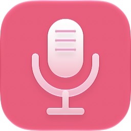
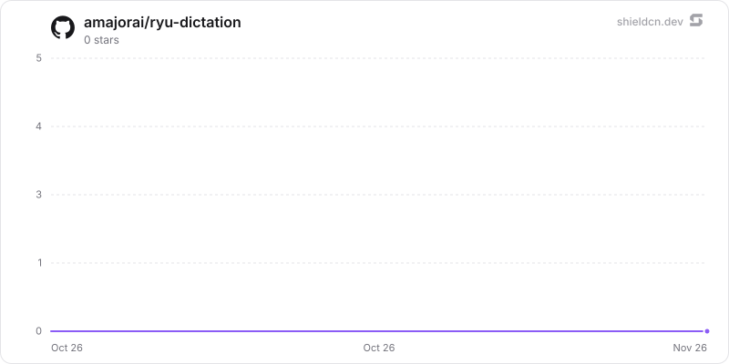

<p align="center">
  <picture>
    <source media="(prefers-color-scheme: dark)" srcset="./icon-dark.png" />
    
  </picture>
</p>

<div align="center">

# Dictation

</div>

System-wide dictation and agent-ask via the Island companion: speak anywhere to type a raw or locally cleaned transcript, or ask an agent and paste the answer into the focused app.

> **The public home of `ryu-dictation`.** Source, builds, and releases live here —
> binaries for every platform are attached to each release.
>
> This tree is generated from the Ryu monorepo, so commits pushed here
> directly are replaced on the next sync. **Pull requests are welcome** —
> open them here and they are ported into the monorepo, then flow back out.
> Ryu as a whole: https://github.com/amajorai/ryu

## Install

**App:** [Install](ryu://apps/@ryu/dictation) (opens the Ryu desktop app and asks you to confirm)

**CLI:**

```bash
ryu apps add @ryu/dictation
```

## Source & build

This is the **source of record** for the app UI. It imports Ryu's private
`@ryu/ui` design system, so it does **not** build standalone outside the
monorepo — it **builds inside the amajorai/ryu monorepo workspace**.
The shipped bundle is the built artifact, produced by the monorepo build.

## License

Apache-2.0 — see [LICENSE](./LICENSE).

## What it provides

- **Dictation** — global shortcut → Island mic capture → Core STT (`parakeet` / `whisper`) → optional transcript cleanup → ghost type/paste into the focused app.
- **Agent ask** — separate shortcut → same capture path → run a chosen agent on the transcript → paste the agent's answer (not the raw transcript).
- **Settings** — desktop settings tab via `contributes.settings_tabs` (agent pickers, shortcuts, engine, insertion). Enabling this plugin is the single on/off switch.

## Role / How it fits

Island is the OS *surface* (global shortcuts, Web Audio capture, focus-preserving insert via ghost MCP). Core owns STT and agent runs. This app owns the identity, policy switch, and settings contribution — the same split as [`apps-store/predict`](../predict/README.md), except the companion process is Island rather than a separate Win32 overlay.

## License

Apache-2.0. See [LICENSE](../../README.md#repository-layout--licensing). © 2026 A Major Pte. Ltd.

## Star History

<a href="https://github.com/amajorai/ryu-dictation/stargazers">
  <picture>
    <source media="(prefers-color-scheme: dark)" srcset="./.github/shieldcn/star-chart-dark.svg" />
    
  </picture>
</a>
